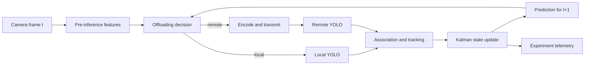

# Integrazione di un filtro di Kalman per tracking e adaptive offloading

## Stato del documento

Proposta architetturale, non ancora implementata. Il documento descrive un
possibile strato di stima dinamica condiviso concettualmente tra applicazione
mobile, servizio remoto e futuro algoritmo di offloading.

## 1. Motivazione

YOLO produce osservazioni frame-by-frame: bounding box, classi e confidence.
Queste osservazioni sono rumorose, possono mancare per alcuni frame e non
descrivono esplicitamente velocita o trend futuri. Un filtro di Kalman puo
trasformare la sequenza di detection in uno stato dinamico composto da:

- posizione e scala filtrate della persona;
- velocita sul piano immagine;
- crescita o riduzione della scala apparente;
- previsione a breve termine;
- incertezza associata alla previsione.

Il filtro non sostituisce YOLO e non decide autonomamente la compliance. Il suo
scopo e fornire al decisore di offloading feature temporali piu stabili e una
previsione del prossimo stato.

Il beneficio architetturale principale e temporale: la decisione local/remote
per il frame `t+1` puo sfruttare lo stato aggiornato fino al frame `t`, senza
dover prima eseguire YOLO localmente sul nuovo frame.

## 2. Collocazione nell'architettura



Il filtro puo risiedere nell'applicazione Android, perche il decisore mobile
deve avere accesso immediato alla previsione. Sul server puo essere mantenuta
una copia per esperimento o sessione, ma non deve diventare l'unica sorgente
dello stato: una perdita di connettivita non deve impedire il percorso locale.

## 3. Vincolo causale della decisione

Le feature YOLO del frame corrente non possono essere usate per decidere se
eseguire quello stesso frame localmente, altrimenti il costo locale e gia stato
pagato. Sono possibili tre categorie di input:

1. feature economiche del frame corrente calcolate prima di YOLO;
2. stato e trend ricavati dai frame precedenti;
3. misure di rete, dispositivo e servizi remoti disponibili al momento della
   decisione.

La previsione Kalman e quindi riferita al frame successivo o a un breve
orizzonte temporale, non costituisce una conoscenza anticipata della detection
corrente.

## 4. Input del filtro geometrico

Per ogni persona associata a una traccia stabile sono disponibili:

- timestamp di acquisizione del frame;
- centro normalizzato della bounding box `person`;
- larghezza e altezza normalizzate;
- area normalizzata e area in pixel;
- confidence della persona;
- sorgente della misura: locale o remota;
- ritardo con cui la misura e diventata disponibile;
- identificatore della traccia;
- eventuale flag di bounding box parzialmente fuori dal frame.

Le coordinate devono riferirsi sempre al frame originale e devono usare la
stessa convenzione del contratto API: `x`, `y`, `width`, `height` normalizzati
in `[0, 1]`.

Prima dell'aggiornamento Kalman serve un livello di associazione. In una scena
con piu persone, una detection deve essere assegnata alla traccia corretta
usando IoU, distanza tra centri, classe e compatibilita temporale. Un tracker
come ByteTrack o BoT-SORT include gia componenti Kalman: in tal caso non deve
essere aggiunto un secondo filtro equivalente senza una responsabilita
distinta.

## 5. Stato consigliato per la persona

Un Minimum Viable Product puo usare:

```text
x = [cx, cy, log(w), log(h), vx, vy, v_log_w, v_log_h]
```

dove:

- `cx`, `cy` sono le coordinate normalizzate del centro;
- `w`, `h` sono larghezza e altezza normalizzate;
- `vx`, `vy` sono le velocita sul piano immagine;
- `v_log_w`, `v_log_h` sono le velocita di variazione della scala.

Il logaritmo garantisce dimensioni positive e descrive bene la crescita
moltiplicativa della bounding box durante l'avvicinamento.

Un modello a velocita costante e sufficiente come baseline. La matrice di
transizione deve usare il `deltaTime` reale ricavato dai timestamp, poiche il
frame rate non e costante.

### Interpretazione della dinamica

- `v_log_h > 0`: persona probabilmente in avvicinamento;
- `v_log_h < 0`: persona probabilmente in allontanamento;
- `abs(v_log_h)` elevato: rapido cambiamento della difficolta visiva;
- covarianza elevata: previsione poco affidabile o traccia intermittente.

Le previsioni possono essere prodotte a orizzonti di 200, 500 e 1000 ms. Per
la decisione frame-by-frame e preferibile l'orizzonte piu vicino; quelli piu
lunghi sono feature contestuali e non garanzie.

## 6. Distanza e velocita radiale

La relazione calibrata tra altezza normalizzata della persona e distanza puo
essere applicata allo stato filtrato. Sono possibili tre strategie:

1. filtrare `log(h)` e convertire successivamente in metri;
2. convertire ogni misura in distanza e filtrare `[distance, velocity]`;
3. usare un Extended o Unscented Kalman Filter con osservazione non lineare.

Per il prototipo e raccomandata la prima strategia. La scala apparente e piu
direttamente collegata alla difficolta del detector e non impone che la
calibrazione metrica sia valida per ogni persona e posa.

Output derivabili:

- distanza corrente stimata;
- velocita radiale;
- avvicinamento, allontanamento o stato stabile;
- distanza prevista al prossimo frame;
- tempo stimato al superamento di una soglia di scala;
- varianza della previsione.

La distanza in metri deve rimanere marcata come stima calibrata. Per il
decisore sono preferibili anche le feature originali `log(h)` e `v_log_h`.

## 7. Stato dei PPE

Dopo aver associato helmet, vest, gloves e safety boots alla persona corretta,
si puo mantenere per ogni oggetto una traccia relativa alla bounding box della
persona.

Uno stato semplice e:

```text
x_ppe = [relative_cx, relative_cy, log(area_px), v_log_area]
```

Possibili output:

- area prevista del PPE nel prossimo frame;
- probabilita che l'oggetto diventi troppo piccolo per il detector locale;
- durata della traccia;
- numero di frame consecutivi senza misura;
- incertezza geometrica.

Una bounding box soltanto predetta non deve essere interpretata come prova
della presenza del PPE e non deve essere mostrata come detection confermata.
Quando manca la misura, la covarianza aumenta; dopo un TTL limitato la traccia
deve essere eliminata.

Per guanti e stivali, che risultano intermittenti nei test sul campo, e
preferibile iniziare dalla sola area osservata e dal missing streak, prima di
introdurre un tracking completo per singolo oggetto.

## 8. Output verso l'algoritmo di offloading

Il decisore dovrebbe ricevere sia stime sia incertezze. Un possibile record e:

```json
{
  "stateTimestamp": 1782900984463,
  "trackId": "person_0",
  "person": {
    "center": [0.51, 0.47],
    "heightNorm": 0.31,
    "heightRatePerSecond": 0.08,
    "motionDirection": "approaching",
    "predictedHeightNorm200ms": 0.326,
    "predictedDistanceM": 4.8,
    "predictionVariance": 0.014,
    "missingFrames": 0
  },
  "ppe": {
    "gloves": {
      "minimumAreaPx": 126,
      "predictedMinimumAreaPx200ms": 141,
      "missingFrames": 2,
      "geometryVariance": 0.09
    }
  },
  "localExecution": {
    "predictedE2eMs": 193.4,
    "deadlineViolationProbability": 0.31
  },
  "remoteExecution": {
    "predictedE2eMs": 146.8,
    "predictionVariance": 218.0
  }
}
```

Feature candidate per il decisore:

- scala corrente e futura della persona;
- velocita di variazione della scala;
- area corrente e futura dei PPE;
- durata e incertezza delle tracce;
- missing streak per classe;
- latenza locale prevista e probabilita di superare 200 ms;
- temperatura e trend termico;
- RTT, throughput, jitter e latenza remota previsti;
- eta dell'ultima misura locale o remota.

La politica puo combinare rischio temporale e rischio visivo:

```text
offload se:
  predicted_local_latency > deadline
  oppure predicted_scene_difficulty e elevata
e:
  predicted_remote_latency < deadline
  e remote_uncertainty e accettabile
```

Isteresi, cooldown e costo di switching devono impedire oscillazioni tra
local e remote.

## 9. Misure remote ritardate

Una risposta remota descrive il frame identificato da `frameId` e dal timestamp
di acquisizione, non il momento in cui arriva al telefono. Se la detection
remota viene applicata direttamente allo stato corrente, il filtro incorpora
una misura temporalmente vecchia.

La gestione corretta richiede:

1. buffer degli stati recenti;
2. aggiornamento al timestamp originale della misura;
3. riproiezione fino al tempo corrente;
4. associazione tramite `frameId`, `trackId` e coordinate normalizzate.

Questa procedura e una gestione di out-of-sequence measurements. Una baseline
piu semplice puo proiettare in avanti la detection remota usando la velocita
corrente, documentando l'approssimazione.

## 10. Filtri per confidence e presenza dei PPE

Un Kalman standard non e ideale per la confidence:

- la variabile e limitata tra zero e uno;
- la distribuzione non e gaussiana;
- una detection mancante non equivale a confidence zero;
- occlusioni e cambi di posa introducono salti improvvisi.

### EWMA sulla confidence

Una Exponentially Weighted Moving Average e una baseline economica. Puo essere
applicata alla trasformazione logit della confidence.

**Pro:** semplice, stabile e facile da implementare.

**Contro:** non produce una vera incertezza probabilistica e reagisce male a
regimi multipli se il fattore di smoothing e fisso.

### Beta-Bernoulli per detection availability

Ogni frame costituisce un successo o fallimento della detection. Una
distribuzione Beta aggiornata nel tempo stima il detection rate recente e la
sua incertezza.

**Pro:** adatta a variabili binarie, output probabilistico interpretabile.

**Contro:** richiede forgetting o finestre mobili per seguire cambi di regime.

### Hidden Markov Model

Stati latenti possibili: `present`, `absent`, `occluded`, `uncertain`.

**Pro:** adatto a compliance e presenza discrete, consente persistenza
temporale senza fingere una traiettoria continua.

**Contro:** transizioni ed emissioni devono essere calibrate; l'assenza di
detection non distingue automaticamente non-compliance e fallimento visivo.

### Missing streak e debounce

Contatori deterministici rappresentano una baseline necessaria:

- frame consecutivi senza detection;
- frame consecutivi sopra una soglia;
- majority vote in una finestra temporale.

Sono facilmente spiegabili e devono essere confrontati con metodi piu
complessi.

## 11. Filtri per stato computazionale e rete

### Latenza locale

Uno stato `[latency, latencyTrend]` puo prevedere il prossimo tempo end-to-end.
Temperatura, CPU e tempo dall'avvio possono essere ingressi esterni.

Il throttling osservato presenta cambi di regime. Un Kalman lineare puo essere
affiancato da:

- change-point detector;
- CUSUM;
- Interacting Multiple Model con regime normale e throttled;
- regressione online con temperatura come covariata.

### Rete e percorso remoto

RTT, throughput, jitter e queue time possono essere smussati con mediane
mobili, EWMA o filtri robusti. La rete cellulare puo avere outlier e code non
gaussiane, quindi un Kalman standard non deve essere assunto come soluzione
universale.

La previsione remota deve separare:

```text
encode + uplink + queue + preprocess + inference + postprocess + downlink
```

Questo consente di identificare quale segmento causa una deadline violation.

## 12. Calibrazione del filtro

Le matrici principali sono:

- `Q`: rumore di processo, legato alla variabilita reale del moto;
- `R`: rumore di misura, legato all'errore di YOLO;
- `P`: incertezza corrente dello stato.

`R` puo essere adattiva:

- aumenta quando la confidence e bassa;
- aumenta per persone o PPE molto piccoli;
- aumenta vicino ai bordi o con box parzialmente tagliate;
- puo dipendere dalla classe e dal modello locale/remoto.

`Q` puo aumentare durante movimenti rapidi o bruschi cambi di direzione. I
parametri devono essere stimati sui dati e non scelti soltanto a intuito.

## 13. Test offline usando i JSONL esistenti

I `frames.jsonl` raccolti permettono di valutare diversi componenti prima di
modificare Android o il server.

### 13.1 Audit temporale

Verificare:

- monotonicita dei timestamp;
- frame mancanti o fuori ordine;
- intervalli temporali reali;
- disponibilita delle bounding box complete;
- differenze tra modello 640 e 960;
- durata dei missing streak per classe.

### 13.2 Replay del tracking persona

Eseguire un replay cronologico:

1. usare le box registrate come misure;
2. aggiornare il filtro usando il `deltaTime` reale;
3. predire a 1, 3 e 5 frame;
4. confrontare la previsione con la successiva box osservata.

Metriche:

- MAE del centro;
- MAE di larghezza e altezza normalizzate;
- IoU tra box prevista e box futura;
- errore di `log(area)`;
- correttezza del segno avvicinamento/allontanamento;
- copertura degli intervalli di confidenza.

### 13.3 Dropout sintetico

Rimuovere artificialmente detection per 1, 2, 3 e 5 frame consecutivi e
misurare quanto il filtro mantiene una previsione utile. Questo simula
occlusioni e instabilita senza richiedere nuovi esperimenti.

Confronti obbligatori:

- last observation carried forward;
- velocita calcolata sugli ultimi due frame;
- EWMA o alpha-beta filter;
- Kalman.

### 13.4 Distanza e velocita radiale

Usare `frames_with_distance.csv` e gli intervalli annotati:

- filtrare `log(person_height_norm)`;
- predire la scala futura;
- convertire opzionalmente in distanza;
- valutare MAE, errore mediano e direzione del moto.

Il punto `15+ m` resta censurato e non deve essere usato come distanza esatta.
La valutazione deve separare fitting e test per intervallo o per esperimento.

### 13.5 Predizione della latenza locale

Usare `inference_ms`, `e2e_ms`, temperatura, CPU e tempo:

- previsione one-step e multi-step;
- rilevazione anticipata del superamento di 200 ms;
- confronto Kalman, EWMA, rolling median e regressione online.

Metriche:

- MAE e p95 dell'errore;
- precision, recall e F1 della previsione di deadline violation;
- anticipo medio del primo allarme;
- Brier score se viene prodotta una probabilita.

### 13.6 Confidence e detection persistence

Per ogni PPE confrontare:

- confidence grezza;
- EWMA;
- Beta-Bernoulli con forgetting;
- HMM;
- missing streak deterministico.

I test sul campo non hanno ground truth completa frame-by-frame. Il detection
frame rate misura disponibilita, non recall. Per una valutazione di compliance
serve annotare manualmente un sottoinsieme di frame o usare un protocollo in
cui la presenza reale dei PPE sia nota per ciascun segmento.

### 13.7 Replay di politiche di offloading

Finche non sono disponibili misure remote reali, il replay puo confrontare:

- sempre locale;
- sempre offload con latenza simulata;
- soglie statiche;
- soglie su trend Kalman;
- policy greedy deadline-aware.

Una simulazione non dimostra la performance della rete 5G reale, ma consente di
validare pipeline, causalita delle feature e logica di decisione.

Metriche finali:

- percentuale di frame entro 100 e 200 ms;
- latenza p50, p95 e p99;
- numero di cambi local/remote;
- tempo trascorso in ciascun percorso;
- accuratezza o proxy di qualita;
- consumo energetico stimato;
- regret rispetto all'oracolo offline.

## 14. Piano di implementazione incrementale

1. Implementare un riferimento Python per replay dei JSONL.
2. Valutare alpha-beta, EWMA e Kalman sulla persona primaria.
3. Definire metriche e split temporali prima del tuning.
4. Aggiungere predizione della latenza locale e change-point detection.
5. Integrare il filtro geometrico in Kotlin con test di parita Python/Android.
6. Esportare stima, covarianza e missing streak nella telemetria.
7. Integrare misure remote timestampate e buffer out-of-sequence.
8. Usare le feature prima in una policy greedy interpretabile.
9. Introdurre il DRL soltanto dopo aver congelato le baseline deterministiche.

Target non funzionale iniziale: meno di 1 ms di overhead medio per poche
tracce, nessun blocco del thread UI e nessuna dipendenza dalla connettivita per
il percorso locale.

## 15. Rischi e non-obiettivi

- Il filtro non corregge errori semantici sistematici del detector.
- Una previsione non e una detection e non deve generare compliance fittizia.
- Il filtro non predice intenzioni o cambi bruschi oltre un breve orizzonte.
- L'incertezza deve crescere durante assenze prolungate di misure.
- La presenza di Kalman non giustifica automaticamente un DRL piu complesso.
- Split inference e migrazione di componenti restano fuori dallo scope: vengono
  trasferiti frame e metadati, in accordo con ADR 0003.

## 16. Raccomandazione

Adottare inizialmente tre stimatori separati:

1. Kalman geometrico sulla persona primaria;
2. EWMA o Beta-Bernoulli per confidence e detection availability dei PPE;
3. filtro robusto della latenza con change-point detection per il regime
   termico.

Gli output devono alimentare prima una policy greedy, insieme alle misure di
rete e server. Solo dopo un confronto offline e sul campo con baseline semplici
ha senso includerli nello stato di un agente di deep reinforcement learning.
